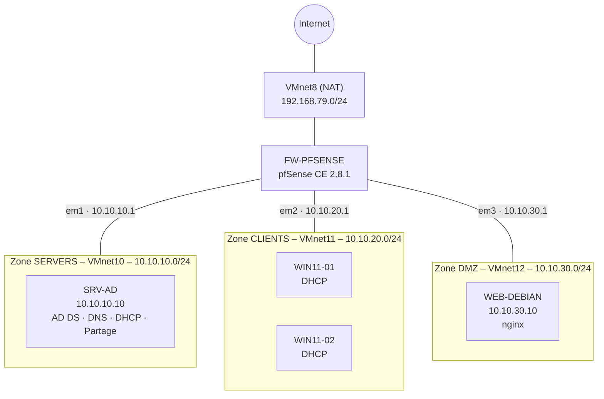

# Lab NexaTech – Réseau d'entreprise segmenté

Maquette complète d'un petit système d'information d'entreprise, montée sous **VMware Workstation** : un pare-feu **pfSense** qui sépare trois zones (serveurs, postes clients, DMZ), un **Active Directory** sous Windows Server, deux postes **Windows 11** joints au domaine et un **serveur web Debian** isolé en DMZ.

> Projet fil rouge « NexaTech », réalisé dans le cadre d'une formation en administration systèmes et réseaux.

---

## Sommaire

1. [Objectifs](#1-objectifs)
2. [Architecture](#2-architecture)
3. [Plan d'adressage](#3-plan-dadressage)
4. [Environnement et versions](#4-environnement-et-versions)
5. [Mise en place, étape par étape](#5-mise-en-place-étape-par-étape)
6. [Politique de filtrage pfSense](#6-politique-de-filtrage-pfsense)
7. [Tests et preuves](#7-tests-et-preuves)
8. [Problèmes rencontrés et solutions](#8-problèmes-rencontrés-et-solutions)
9. [Limites et améliorations](#9-limites-et-améliorations)
10. [Reste à faire](#10-reste-à-faire)

---

## 1. Objectifs

- Segmenter le réseau en **zones de confiance** séparées par un pare-feu.
- Mettre en place un **annuaire Active Directory** avec DNS, DHCP, GPO et partage de fichiers.
- Distribuer les adresses des postes clients via un **relais DHCP** à travers le pare-feu.
- Publier un **site web en DMZ**, accessible aux employés mais **incapable d'atteindre le réseau interne**.
- **Prouver** chaque point par des tests positifs (ce qui doit passer passe) et négatifs (ce qui doit être bloqué l'est).

---

## 2. Architecture



**Principe :** pfSense est la seule machine branchée sur les quatre réseaux. Tout trafic **entre deux zones** passe obligatoirement par lui, ce qui lui permet de l'autoriser ou de le bloquer.

| Zone | Niveau de confiance | Politique par défaut |
|---|---|---|
| SERVERS | Élevé | Tout autorisé en sortie (règle par défaut « allow LAN to any ») |
| CLIENTS | Moyen | Tout interdit, sauf ce qui est explicitement ouvert |
| DMZ | Faible (exposée) | Tout interdit, sauf DNS vers pfSense et web vers Internet |

---

## 3. Plan d'adressage

### Réseaux virtuels VMware

| VMnet | Type | Sous-réseau | DHCP VMware | Carte de l'hôte | Rôle |
|---|---|---|---|---|---|
| VMnet8 | NAT | 192.168.79.0/24 | Activé | Oui | WAN (accès Internet) |
| VMnet10 | Host-only | 10.10.10.0/24 | **Désactivé** | **Non** | SERVERS |
| VMnet11 | Host-only | 10.10.20.0/24 | **Désactivé** | **Non** | CLIENTS |
| VMnet12 | Host-only | 10.10.30.0/24 | **Désactivé** | **Non** | DMZ |

> Le sujet prévoyait VMnet20 et VMnet30. Sous Windows, VMware Workstation ne propose que VMnet0 à VMnet19 : les zones CLIENTS et DMZ utilisent donc VMnet11 et VMnet12, avec les sous-réseaux prévus.

**Pourquoi désactiver le DHCP de VMware :** les adresses sont gérées par nos propres services (IP fixes pour les serveurs, DHCP Windows pour les clients). Deux DHCP sur le même réseau se contrediraient.

**Pourquoi décocher la carte de l'hôte :** sinon le PC hôte prend l'adresse `.1` de chaque réseau, en conflit avec pfSense, et crée un chemin qui contourne le pare-feu.

### Machines

| Machine | Système | Zone / VMnet | Adresse IP | Passerelle | DNS | RAM | Disque |
|---|---|---|---|---|---|---|---|
| FW-PFSENSE | pfSense CE 2.8.1 | 4 cartes | WAN : DHCP (192.168.79.137)<br/>em1 : 10.10.10.1/24<br/>em2 : 10.10.20.1/24<br/>em3 : 10.10.30.1/24 | – | – | 2 Go | 20 Go |
| SRV-AD | Windows Server 2022 Standard (expérience de bureau) | SERVERS / VMnet10 | 10.10.10.10/24 (fixe) | 10.10.10.1 | 10.10.10.10 | 4 Go | 60 Go |
| WIN11-01 | Windows 11 Entreprise | CLIENTS / VMnet11 | DHCP (10.10.20.100–200) | 10.10.20.1 | 10.10.10.10 | 4 Go | 64 Go |
| WIN11-02 | Windows 11 Entreprise | CLIENTS / VMnet11 | DHCP (10.10.20.100–200) | 10.10.20.1 | 10.10.10.10 | 4 Go | 64 Go |
| WEB-DEBIAN | Debian 12.15 (netinst, sans interface graphique) | DMZ / VMnet12 | 10.10.30.10/24 (fixe) | 10.10.30.1 | 10.10.30.1 | 2 Go | 20 Go |

Toutes les VM : 1 processeur × 2 cœurs.

### Correspondance des interfaces pfSense

| Carte VMware | VMnet | Interface pfSense | Nom | Adresse |
|---|---|---|---|---|
| Network Adapter 1 | VMnet8 | em0 | WAN | DHCP |
| Network Adapter 2 | VMnet10 | em1 | SERVERS (ex-LAN) | 10.10.10.1/24 |
| Network Adapter 3 | VMnet11 | em2 | CLIENTS (ex-OPT1) | 10.10.20.1/24 |
| Network Adapter 4 | VMnet12 | em3 | DMZ (ex-OPT2) | 10.10.30.1/24 |

---

## 4. Environnement et versions

| Composant | Version / source |
|---|---|
| Hyperviseur | VMware Workstation Pro 17.5 |
| Pare-feu | pfSense CE 2.8.1 (installé via le Netgate Installer v1.2, AMD64 ISO) |
| Contrôleur de domaine | Windows Server 2022 Standard Evaluation (180 jours) |
| Postes clients | Windows 11 Entreprise Evaluation (90 jours) |
| Serveur web | Debian 12.15 « Bookworm » netinst amd64 + nginx |
| Domaine Active Directory | `ad.nexatech.lan` (NetBIOS : `AD`) |

---

## 5. Mise en place, étape par étape

### Phase A – Réseaux et machines virtuelles

1. **Edit → Virtual Network Editor → Change Settings.**
2. Garder **VMnet8 en NAT** sans le modifier.
3. Créer **VMnet10, VMnet11, VMnet12** en Host-only : décocher la carte de l'hôte et le DHCP, renseigner les sous-réseaux.
4. Créer les 5 VM vides (« I will install the operating system later »).
5. Brancher chaque carte réseau sur son VMnet et monter l'ISO correspondante.

> Distinction importante : le **Virtual Network Editor** crée les *switchs*, les **réglages de la VM** branchent les *cartes* sur ces switchs. pfSense ne fait que configurer les cartes qu'il voit, il ne peut pas en créer.

### Phase B – pfSense

**Installation**
- Auto (ZFS), GPT, stripe, disque `da0`.
- Netgate Installer : WAN = `em0` en DHCP, LAN = `em1`, édition **CE**, version 2.8.1.
- Retirer l'ISO après l'installation (décocher *Connected* et *Connect at power on*).

**Console**
- Option `1` : WAN `em0`, LAN `em1`, OPT1 `em2`, OPT2 `em3`.
- Option `2` : adresses `10.10.10.1/24`, `10.10.20.1/24`, `10.10.30.1/24`, sans serveur DHCP pfSense.
- Option `7` : `ping 8.8.8.8` pour vérifier la sortie Internet.

**Interface web** (depuis SRV-AD : `https://10.10.10.1`)
- Assistant : hostname `FW-PFSENSE`, domaine `nexatech.example`, fuseau Europe/Paris.
- WAN : **décocher « Block RFC1918 Private Networks »** (notre « Internet » VMnet8 est lui-même en 192.168.x), garder « Block bogon networks ».
- Changer le mot de passe admin.
- Renommer les interfaces : LAN → **SERVERS**, OPT1 → **CLIENTS**, OPT2 → **DMZ**.
- Créer l'alias **`PORTS_WEB`** (80, 443) et les règles de filtrage (voir section 6).

### Phase C – Active Directory et DNS

1. Installer Windows Server 2022 **avec expérience de bureau**, renommer en `SRV-AD`, IP fixe `10.10.10.10`.
2. Rôles **AD DS** et **Serveur DNS**.
3. Promotion : nouvelle forêt **`ad.nexatech.lan`**, serveur DNS et catalogue global cochés, NetBIOS `AD`.
4. Vérifications : zones `ad.nexatech.lan` et `_msdcs.ad.nexatech.lan`, partages `NETLOGON` et `SYSVOL` (`net share`), `nltest /dsgetdc:ad.nexatech.lan`.
5. **Redirecteur DNS** vers `10.10.10.1` (pfSense), pour résoudre les noms publics.
6. Objets de l'annuaire :
   - OU `Utilisateurs`, `Postes`, `Groupes` ;
   - utilisateurs `alice` et `bob` dans `Utilisateurs` ;
   - groupe de sécurité global **`GG_Employes`** (alice, bob) dans `Groupes`.

> Chemin DNS : client → SRV-AD (domaine interne) → pfSense (redirecteur) → Internet. Les postes n'ont qu'un seul DNS, et le domaine comme Internet fonctionnent.

### Phase D – DHCP et relais

**Sur SRV-AD**
- Rôle **Serveur DHCP**, puis autorisation dans l'AD.
- Étendue **CLIENTS** : `10.10.20.100` à `10.10.20.200`, masque `/24`.
- Options : **003** routeur `10.10.20.1`, **006** DNS `10.10.10.10`, **015** domaine `ad.nexatech.lan`.

**Sur pfSense** (Services → DHCP Relay)
- DHCP Server désactivé sur toutes les interfaces.
- Relais activé sur **CLIENTS**, serveur amont **`10.10.10.10`**.

> Une demande DHCP est un *broadcast* qui ne traverse pas un routeur. Le relais l'écoute côté clients, la transmet au serveur en indiquant le réseau d'origine (`10.10.20.1`), puis rapporte la réponse. La passerelle `10.10.20.1` est volontairement **hors de la plage distribuée**, pour qu'elle ne soit jamais attribuée à un poste.

### Phase E – Postes clients dans le domaine

1. Installer Windows 11 Entreprise (UEFI + Secure Boot + TPM virtuel), compte local via « Joindre un domaine à la place ».
2. Vérifier : `ipconfig /all`, `nslookup ad.nexatech.lan`, `w32tm /stripchart /computer:10.10.10.10`.
3. Joindre le domaine `ad.nexatech.lan` (`sysdm.cpl`), redémarrer.
4. Se connecter en `AD\alice` / `AD\bob` : `whoami`, `echo %LOGONSERVER%`, `gpresult /r`.
5. Déplacer `WIN11-01` et `WIN11-02` du conteneur **Computers** vers l'OU **Postes**.

> WIN11-02 a été installé de zéro et non cloné : deux Windows clonés sans `sysprep` partagent le même SID, ce qui provoque des échecs d'authentification dans un domaine.

### Phase F – GPO et partage de fichiers

**GPO `GPO_Verrouillage_Session`**, liée à l'OU **Postes**
- Configuration ordinateur → Stratégies → Paramètres Windows → Paramètres de sécurité → Stratégies locales → Options de sécurité.
- « Ouverture de session interactive : limite d'inactivité de l'ordinateur » = **300 s**.

> Le réglage est dans « Configuration **ordinateur** » car la GPO est liée à une OU qui contient des **ordinateurs**. Un réglage « utilisateur » ne s'appliquerait pas : alice et bob sont dans l'OU Utilisateurs.

**Partage `\\SRV-AD\Equipe`** (dossier `C:\Partage_Equipe`)
- Autorisations de partage : *Tout le monde* supprimé, **GG_Employes** en Lecture + Modifier.
- Autorisations NTFS : **GG_Employes** en Modification.

> Double serrure : les droits réels sont **les plus restrictifs** entre le partage (accès réseau) et NTFS (toujours appliqué).

### Phase G – Serveur web en DMZ

1. Debian netinst, réseau configuré à la main (pas de DHCP en DMZ) : `10.10.30.10/24`, passerelle et DNS `10.10.30.1`.
2. Mot de passe root laissé vide pour disposer de `sudo`.
3. Logiciels : **serveur SSH** + **utilitaires usuels** uniquement (pas d'interface graphique, pas d'Apache).
4. Installation de nginx :

```bash
sudo apt update
sudo apt install nginx -y
sudo systemctl enable --now nginx
echo '<meta charset="utf-8"><h1>Site NEXATECH - zone DMZ</h1>' | sudo tee /var/www/html/index.html
```

> Le serveur web reste **volontairement hors du domaine** : une DMZ doit pouvoir être compromise sans mettre en danger le réseau interne. La joindre à l'AD obligerait à ouvrir des flux DMZ → SERVERS.

---

## 6. Politique de filtrage pfSense

Les trois règles d'or appliquées :

1. Les règles se lisent **de haut en bas**, la première qui correspond l'emporte.
2. Une règle s'écrit sur l'interface **par où le trafic entre**.
3. **Ce qui n'est pas autorisé est interdit.**

**Alias :** `PORTS_WEB` = TCP 80, 443.

### Onglet CLIENTS

| # | Action | Protocole | Source | Destination | Port | Log | Justification |
|---|---|---|---|---|---|---|---|
| 1 | Pass | Any | CLIENTS subnets | 10.10.10.10 (SRV-AD) | Tous | – | AD, DNS, Kerberos, LDAP, SMB… (règle **temporaire**, à resserrer) |
| 2 | Pass | TCP | CLIENTS subnets | 10.10.30.10 (WEB-DEBIAN) | PORTS_WEB | – | Consulter le site de l'entreprise |
| 3 | Block | Any | CLIENTS subnets | 10.10.10.0/24 | Tous | ✅ | Interdire le reste de la zone serveurs |
| 4 | Block | Any | CLIENTS subnets | 10.10.30.0/24 | Tous | ✅ | Interdire le reste de la DMZ (SSH, etc.) |
| 5 | Pass | TCP | CLIENTS subnets | Any | PORTS_WEB | – | Navigation Internet |

### Onglet DMZ

| # | Action | Protocole | Source | Destination | Port | Log | Justification |
|---|---|---|---|---|---|---|---|
| 1 | Pass | TCP/UDP | DMZ subnets | DMZ address (10.10.30.1) | 53 | – | Résolution DNS via pfSense |
| 2 | Block | Any | DMZ subnets | 10.10.10.0/24 | Tous | ✅ | La DMZ ne doit jamais atteindre les serveurs |
| 3 | Block | Any | DMZ subnets | 10.10.20.0/24 | Tous | ✅ | La DMZ ne doit jamais atteindre les postes |
| 4 | Pass | TCP | DMZ subnets | Any | PORTS_WEB | – | Mises à jour Debian, installation de nginx |

### Onglet SERVERS

Règles par défaut conservées : *Anti-Lockout Rule* (accès à l'interface web) et *Default allow LAN to any*.

> **Pourquoi les blocages avant « Any » :** « Any » inclut aussi les autres zones. Placée en premier, une règle « Pass vers Any » laisserait tout passer et les blocages ne seraient jamais lus.

> **Relais DHCP :** aucune règle à ajouter. pfSense autorise automatiquement les requêtes DHCP des clients vers lui-même, et la réponse de SRV-AD entre par SERVERS, où tout est permis.

---

## 7. Tests et preuves

| # | Test | Depuis | Commande / action | Attendu | Résultat |
|---|---|---|---|---|---|
| 1 | Sortie Internet de pfSense | pfSense | Diagnostics → Ping `www.debian.org` | Réponses | ✅ 0 % de perte |
| 2 | Lien SERVERS ↔ pfSense | SRV-AD | `ping 10.10.10.1` | Réponses | ✅ |
| 3 | Redirecteur DNS | SRV-AD | `nslookup www.google.com 10.10.10.10` | Réponse immédiate | ✅ |
| 4 | DHCP via relais | WIN11-01 | `ipconfig /all` | 10.10.20.x, passerelle .1, DNS 10.10.10.10 | ✅ 10.10.20.100 |
| 5 | Domaine | WIN11-01/02 | `whoami`, `gpresult /r` | `ad\alice`, `ad\bob` | ✅ |
| 6 | Partage | WIN11-01 et 02 | `\\SRV-AD\Equipe` | Fichier visible des deux postes | ✅ |
| 7 | Web en DMZ | WIN11-01 | `http://10.10.30.10` | Page NEXATECH | ✅ |
| 8 | DNS depuis la DMZ | WEB-DEBIAN | `ping deb.debian.org` | Nom résolu, ping bloqué (ICMP non autorisé) | ✅ comportement voulu |
| 9 | **Isolation DMZ → AD** | WEB-DEBIAN | `nc -zv -w 3 10.10.10.10 445` | Échec | ✅ *timed out* |
| 10 | Flux autorisé (témoin) | WEB-DEBIAN | `nc -zv -w 3 deb.debian.org 80` | Succès | ✅ *succeeded* |
| 11 | Journalisation | pfSense | Status → System Logs → Firewall | Ligne de blocage 10.10.30.10 → 10.10.10.10:445 | ☐ |

> Les tests 9 et 10 se lisent ensemble : comme le web passe, le réseau fonctionne, et le blocage vers le port 445 est bien une **décision du pare-feu**, pas une panne. Le *timed out* (et non *refused*) montre que le paquet est jeté silencieusement par l'action **Block**.

> **Tester un port plutôt que pinguer :** le ping (ICMP) est souvent bloqué. Côté Windows : `Test-NetConnection 10.10.30.10 -Port 80`. Côté Linux : `nc -zv`.

---

## 8. Problèmes rencontrés et solutions

### Domaine `ad.nexatech.example` refusé par le DNS (le plus important)

**Symptômes**
- Après la promotion, aucune zone de recherche directe, ni `ad.nexatech.example` ni `_msdcs`.
- Création manuelle impossible : *« Impossible de créer la zone. Le nom n'est pas valide »* (`WIN32 123`), y compris en zone stockée dans un fichier.
- Événements DNS 4013, 404, 407 et 408 dans l'observateur.

**Diagnostic par élimination**

| Hypothèse | Test | Conclusion |
|---|---|---|
| Réseau / pfSense | `ipconfig`, ping, navigation | ❌ écarté |
| Service DNS en panne | Écoute sur toutes les IP, `nslookup www.google.com 10.10.10.10` | ❌ écarté, le DNS répond |
| Stockage AD | Zone en fichier : même erreur | ❌ écarté |
| **Le nom lui-même** | Zone `test.local` : **créée** | ✅ **cause identifiée** |

**Solution :** rétrogradation du contrôleur de domaine, puis nouvelle promotion avec la forêt **`ad.nexatech.lan`**. Les zones `ad.nexatech.lan` et `_msdcs.ad.nexatech.lan` ont été créées automatiquement.

**Analyse :** `.example` est réservé par les RFC 2606 et 6761 à la documentation. Le DNS de Windows Server refuse vraisemblablement de l'héberger. Leçon : un nom de domaine AD se choisit avec soin, car il est quasiment impossible à changer ensuite. Bonnes pratiques : un sous-domaine d'un domaine possédé (`ad.entreprise.com`) ou `.internal` ; éviter `.local` (conflit mDNS) et les extensions réservées (`.example`, `.test`, `.invalid`).

> Les erreurs 404/407/408 (*« impossible de lier un socket à 10.10.10.10 »*) dataient d'un démarrage où la carte réseau n'était pas encore prête. Elles n'étaient pas la cause.

### Autres difficultés

| Problème | Cause | Solution |
|---|---|---|
| Impossible de créer VMnet20 et VMnet30 | VMware sous Windows limite à VMnet0–19 | Utiliser VMnet11 et VMnet12 avec les bons sous-réseaux |
| VMnet8 passé en Host-only par erreur | Mauvaise sélection dans l'éditeur | Remettre NAT, puis Apply |
| LAN pfSense assigné à `em2` au lieu de `em1` | Mauvaise ligne sélectionnée dans l'installateur | Réassigner `em1` (vérification par les adresses MAC) |
| WAN de pfSense sans IPv4 | Option `2` appliquée au WAN au lieu du LAN | Remettre le WAN en DHCP |
| Ping SRV-AD → pfSense : « hôte de destination inaccessible » | Nouvelles adresses pas totalement appliquées après plusieurs modifications en console | Redémarrage de pfSense (option `5`) |
| *Missing or expired CSRF token* dans pfSense | Formulaire resté ouvert plusieurs heures | Se reconnecter, vérifier les règles, recréer la règle manquante |
| Règle créée sur l'interface WAN | Bouton *Add* cliqué depuis l'onglet WAN | Recréer la règle depuis l'onglet CLIENTS |
| Installation Windows 11 bloquée sur les mises à jour | Téléchargement pendant l'OOBE | Débrancher la carte réseau pendant l'installation |
| WIN11 figé après inactivité | Mise en veille mal gérée dans la VM | `powercfg /change standby-timeout-ac 0` et `monitor-timeout-ac 0`, désactiver l'accélération 3D |
| Client en `169.254.x.x` | Pas de réponse DHCP | Relais pfSense + étendue active et serveur autorisé |
| `\\SRV-AD\Equipe` : « nom de réseau introuvable » | Partage pas encore créé | `net share` pour vérifier, puis création du partage |
| Debian : bureau GNOME installé, SSH absent | *Entrée* valide l'écran ; c'est *Espace* qui coche | Réinstallation avec la bonne sélection |
| Debian : « insérer le support… » en boucle | Lecteur CD reconnecté en cours d'installation | Réinstallation ; démarrage sur le CD via le BIOS (onglet Boot) |
| Option « serveur web » cochée par défaut | Elle installe Apache, en conflit avec nginx sur le port 80 | Décocher avant de valider |

---

## 9. Limites et améliorations

### Limites

- **Un seul contrôleur de domaine** : s'il tombe, plus aucune authentification ni résolution DNS interne.
- Les VMnet simulent la segmentation, mais ce ne sont **pas de vrais VLAN**.
- La règle CLIENTS → SRV-AD est encore **large** (tous ports).
- Le site web est en **HTTP**, donc non chiffré.
- Zone DNS et mises à jour : nom `.lan` non officiellement réservé.
- **Aucune sauvegarde** (AD, configuration pfSense).
- Journaux stockés **localement** sur pfSense, avec un espace limité.

### Améliorations possibles

1. Ajouter un **second contrôleur de domaine** pour la tolérance de panne.
2. Passer le site en **HTTPS** avec un certificat (autorité interne ou Let's Encrypt).
3. **Resserrer** la règle vers l'AD à un alias `PORTS_AD`, et fixer la plage RPC dynamique sur le serveur.
4. **Centraliser les journaux** (syslog distant, SIEM).
5. Mapper le partage en lecteur réseau par **GPO** (Configuration utilisateur → Préférences → Mappages de lecteurs).
6. Sauvegarder régulièrement `config.xml` de pfSense et l'état système de l'AD.

---

## 10. Reste à faire

- [ ] Capture de la ligne de blocage dans *Status → System Logs → Firewall*.
- [ ] Tests de ports depuis WIN11-01 : `Test-NetConnection` vers 10.10.30.10:80 (True), 10.10.30.10:22 (False), 10.10.10.10:445 (True).
- [ ] Remplacer la règle CLIENTS n°1 par un alias **`PORTS_AD`** :
      `53, 88, 123, 135, 389, 445, 464, 636, 3268, 49152:65535` (TCP/UDP), puis retester domaine, GPO et partage.
- [ ] Mini-incident sur WIN11-02 (DNS incorrect, mauvais VMnet, règle bloquante ou heure décalée) et diagnostic couche par couche :
      câblage → IP → passerelle → DNS → ports → authentification.
- [ ] Vérifier le verrouillage automatique de session après 5 minutes.

---

*Les mots de passe du lab ne figurent volontairement dans aucun fichier de ce dépôt ni dans les captures.*
